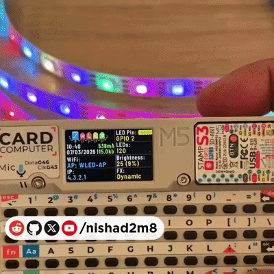

# WLED Cardputer



---
<p align="center">
  <span style="color: yellow;">If you like this, consider supporting it:</span>
</p>

<p align="center">
  <a href="https://www.buymeacoffee.com/nishad2m8" target="_blank">
    
  </a>
  <a href="https://www.youtube.com/channel/UCV_35rUyf4N5mHZXaxaFKiQ" target="_blank">
    
  </a>
</p>


---

A custom [WLED](https://github.com/wled-dev/WLED) build for the **M5Stack Cardputer**, featuring a built-in LVGL display interface and keyboard control for LED strips.

Built on top of [WLED](https://kno.wled.ge) by [Aircoookie](https://github.com/Aircoookie) — a fast, feature-rich ESP32 webserver for controlling NeoPixel (WS2812B, WS2811, SK6812) and SPI-based (WS2801, APA102) LEDs.

## Features

- Full WLED functionality (100+ effects, 50+ palettes, segments, presets, OTA updates)
- LVGL-based display showing WiFi status, IP, brightness, current effect, time, and system info
- Keyboard controls for hands-on operation without needing the web UI
- Default LED output on GPIO 21

## Controls

### Button

| Button | Action |
|--------|--------|
| G0 (GPIO 0) | Toggle LEDs on/off |

### Keyboard

| Key | Action |
|-----|--------|
| `,` | Brightness down |
| `/` | Brightness up |
| `;` | Next effect |
| `.` | Previous effect |
| `f` | Fade LEDs on/off |
| `h` | Show or hide keyboard help |
| `c` | Configure effects for keys `1`–`5` |
| `1`–`5` | Start the assigned effect |

Brightness changes in steps of 25 (0–255 scale).
The `f` key uses WLED's configured transition time.
Press `c`, browse effects with `.` and `;`, then press `1`–`5` to assign the selected effect. Assignments are saved across restarts.

## Display Info

The Cardputer's built-in screen shows:

- WiFi SSID and IP address
- LED pin and count
- Brightness (value and bar)
- Battery charge estimate
- Current effect name
- Time and date
- Estimated current draw
- Free heap memory

## Building

Requires [PlatformIO](https://platformio.org/).

```
pio run -e m5stack_cardputer
```

## Flashing

### PlatformIO

```
pio run -e m5stack_cardputer -t upload
```

### Pre-built Binary

A pre-built `WLED-CardPuter.bin` is available for direct flashing. You can also find it in **M5Burner** and the **M5SLauncher** for easy installation without needing to compile from source.

## License

Licensed under the [EUPL v1.2](LICENSE).

Based on [WLED](https://github.com/wled-dev/WLED) — all credit to the WLED project and its [contributors](https://kno.wled.ge/about/contributors/).
